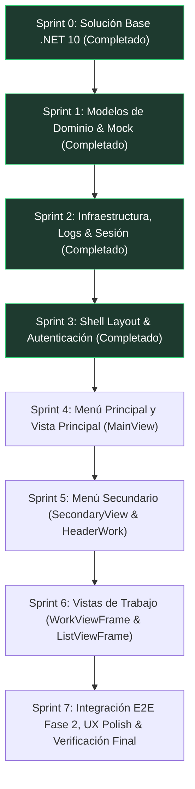

# Plan de Implementación por Sprints - Proyecto Vogel

Basado en el documento de especificación [RequerimientoMaestro.md](file:///f:/LABORATORIO/2026/VogelM1/RequerimientoMaestro.md).

---

## 1. Lineamientos Generales y Estándares

* **Plataforma:** Solución Blazor WebAssembly App (ASP.NET Core Hosted) sobre **.NET 10 (LTS)**.
* **Estructura de Proyectos:** `Vogel.Client`, `Vogel.Server` y `Vogel.Shared`.
* **Convención de Nombres:** 
  * Código (archivos, clases, métodos, variables, atributos, IDs HTML/CSS) en **Inglés**.
  * Comentarios y documentación técnica en **Español**.
* **Patrón de Vistas:** **Code-Behind** estricto (`.razor` + `.razor.cs`) para componentes y vistas.
* **Control de UI y Experiencia de Usuario:** 
  * Bloqueo de controles y overlays visuales durante operaciones asíncronas para evitar doble envío o clics repetidos.
  * Captura y visualización amigable de errores en la interfaz (sin errores huérfanos o no controlados en la consola del navegador).
* **Flujo por Sprints:** Cada sprint concluye con una **Fase de Verificación** obligatoria antes de iniciar el siguiente.

---

## 2. Mapa de Sprints



---

## Sprint 0: Arquitectura Base y Solución Hosted (.NET 10)

### Objetivo
Establecer la estructura de proyectos limpia (.NET 10), configuración inicial de dependencias, scripts de compilación y verificación de entorno de desarrollo.

### Tareas
1. **Creación de la Solución:**
   * Crear solución `Vogel.sln` con plantilla Blazor WebAssembly Hosted en .NET 10:
     * `Vogel.Client` (Blazor WebAssembly)
     * `Vogel.Server` (ASP.NET Core Host)
     * `Vogel.Shared` (Biblioteca de clases compartidas)
2. **Configuración de Dependencias Base:**
   * Paquetes NuGet esenciales (`Serilog.AspNetCore`, librerías criptográficas auxiliares) y almacenamiento de sesión nativo del navegador vía JS Interop.
3. **Estructura de Directorios:**
   * En `Vogel.Client`: `Components/`, `Pages/`, `Services/`, `Models/`, `wwwroot/icons/`, `wwwroot/css/`.
   * En `Vogel.Server`: `Controllers/`, `Filters/`, `Services/`.
   * En `Vogel.Shared`: `Models/`, `DTOs/`, `Enums/`.
4. **Validación de Compilación y Ejecución:**
   * Compilación limpia mediante `dotnet build`.

### Criterio de Verificación (Sprint Review)
- [x] La solución compila con 0 errores y 0 warnings en .NET 10.
- [x] Al ejecutar `dotnet run --project Vogel.Server`, la aplicación carga en el navegador localmente.
- [x] La estructura de carpetas cumple con la convención de nombres y separación de responsabilidades.

---

## Sprint 1: Modelos de Dominio, DTOs y Mock Service de Datos

### Objetivo
Definir los contratos de datos requeridos por el requerimiento maestro e implementar el proveedor de datos simulados (`MockDataProvider`) para la Fase 2.

### Tareas
1. **Modelos de Seguridad y Usuario (`Vogel.Shared`):**
   * `User`: `username`, `name`, `avatar`, `type_authentication`, `allow_password_change`, `privileges`.
   * `Privilege`: `id_parent`, `id`, `codename`, `group`, `title`, `action`, `icon`, `access`.
   * `PrivilegeAccess`: acciones de acceso (`create`, `modify`, `read`, `delete`, `validate`, `execute`, `approve`).
2. **Modelos de Trabajo Maestro-Detalle (`Vogel.Shared`):**
   * `BlockWork`: `codename`, `show_info`, `title`, `key_master_attribute`, `key_detail_attribute`, `action_set`, `view_set`.
   * `ActionBlockWork`: URLs relativas de acciones (`start`, `capture`, `remove`, `cancel_master`, `apply_master`, `rev_apply_master`, `list_detail_master`, `doc_master`, `rep_master`, `exit`).
   * `ViewBlockWork`: URLs relativas de vistas (`info`, `capture`, `filter`, `list`).
3. **Mock Data Provider (`Vogel.Client` / `Vogel.Shared`):**
   * Implementación de clase `MockDataService`:
     * Usuarios de prueba (ej. usuario con auth interna y cambio de contraseña permitido, usuario externo sin cambio de contraseña).
     * Árbol de privilegios con nodos raíz (**Arranque 1**, **Arranque 2**), subopciones directas ("**Entre Aquí**"), y subopciones de menú secundario ("**2.1**").
     * Instancia mock de `BlockWork` con sus acciones y vistas asociadas.
4. **Pruebas Unitarias:**
   * Pruebas para la jerarquía del árbol de privilegios (filtrado por `id_parent == 0` y subordinados).

### Criterio de Verificación (Sprint Review)
- [x] Modelos compilados y comentados en español según directrices.
- [x] El servicio mock entrega la estructura de datos requerida para el escenario DEMO.
- [x] Pruebas unitarias de modelos ejecutadas y aprobadas (`dotnet test`).


---

## Sprint 2: Infraestructura, Logging, Seguridad y Sesión

### Objetivo
Implementar los componentes transversales de seguridad (servidor y cliente), manejo de excepciones, auditoría y control de inactividad.

### Tareas
1. **Configuración de Seguridad en Servidor (`Vogel.Server`):**
   * Middleware de Cabeceras HTTP de Seguridad (CSP, `X-Frame-Options`, `Referrer-Policy`, `X-XSS-Protection`) configurables desde `appsettings.json`.
   * Configuración de cookies seguras (`Secure`, `HttpOnly`, `SameSite=Strict`).
   * `GlobalExceptionFilter` para captura y sanitización de excepciones en controladores API.
2. **Sistema de Logging Unificado:**
   * Servidor: Integración con Serilog para rotación diaria en archivo de texto configurable en `appsettings.json`.
   * Cliente: Servicio `ClientLogger` para envío asíncrono de eventos, advertencias y excepciones al endpoint de logging en el servidor.
3. **Gestión Cifrada de Sesión:**
   * `CryptoHelper` para cifrado/descifrado de datos en almacenamiento local/sesión.
   * Servicio wrapper sobre `sessionStorage` nativo del navegador (JS Interop) para persistencia segura de estado de navegación (ej. `idParent` activo).
4. **Monitoreo de Inactividad (`InactivityMonitor`):**
   * Componente Blazor con JS Interop para escuchar eventos de usuario (`click`, `mousemove`, `keypress`).
   * Lógica de temporizador basada en `InactivityTimeoutMinutes` de `appsettings.json`.
   * Despacho automático de `LogoutAsync` y redirección a login al cumplirse el tiempo.

### Criterio de Verificación (Sprint Review)
- [x] Las respuestas del servidor incluyen las cabeceras de seguridad requeridas.
- [x] El log del servidor genera archivo diario con formato estructurado.
- [x] El `ClientLogger` envía logs de prueba al servidor y se registran correctamente en disco.
- [x] El temporizador de inactividad detecta interacción y dispara el flujo de logout si se deja expirar.


---

## Sprint 3: Shell Layout y Módulo de Autenticación (LoginView) (Completado)

### Objetivo
Desarrollar la estructura visual de la aplicación (Header, Body, Footer) y el flujo completo de inicio de sesión con soporte para "Recordar Sesión", reCAPTCHA y cambio de contraseña.

### Tareas
1. **Estructura del Layout Principal (`MainLayout`):**
   * **Header:**
     * [x] Izquierda: Logo y nombre de la aplicación (clic redirige a `MainView` / `/`).
     * [x] Derecha: Bloque de usuario (username + avatar según configuración), botón/enlace de "Cambio de Clave" (condicionado a `allow_password_change`), botón con icono para "Cerrar Sesión".
     * [x] Modo responsive: menú tipo burger para pantallas móviles.
   * **Footer:**
     * [x] Componente desacoplado `DefaultFooter` con información global y versión del sistema.
   * **Overlay Global de Carga / Bloqueo:**
     * [x] Mecanismo para bloquear la pantalla e indicar progreso durante tareas asíncronas y cierre de sesión.
   * **InactivityMonitor:**
     * [x] Integrado en `MainLayout` para control de expiración de sesión por inactividad.
2. **Vistas y Componentes de Login:**
   * [x] `LoginView.razor` y `LoginView.razor.cs`.
   * [x] Componente `Login.razor` (`username`, `password`, botones "Ingresar", "Cancelar" y "Limpiar").
   * [x] Integración de casilla "Recordar Sesión" (habilitable desde `appsettings.json`).
   * [x] Componente de reCAPTCHA configurable (`ReCaptcha.razor` con modos Deshabilitado, Siempre exigido, Exigido por condición).
   * [x] `ChangePasswordView.razor` y `ChangePasswordView.razor.cs` (tarjeta centrada y validaciones).
   * [x] Foco automático inicial en primer campo (`autofocus` + `FocusOnNavigate` + FocusAsync tras render y limpieza).
3. **Flujo de Autenticación:**
   * [x] Conexión con `AuthenticationService` (usando `MockDataService` en esta fase).
   * [x] Generación del rol base `Único`.
   * [x] Manejo de error visual ("Usuario o Clave incorrectos") con limpieza automática de credenciales en UI.
   * [x] Cifrado de sesión en `CryptoHelper` 100% compatible con WebAssembly (WASM).
   * [x] Redirección exitosa a `MainView`.

### Criterio de Verificación (Sprint Review)
- [x] Pantalla de login responsiva y estética, con validaciones de campos requeridos y foco automático.
- [x] Intento de login fallido muestra mensaje de error amigable en UI y limpia automáticamente las credenciales.
- [x] Login exitoso asigna credenciales simuladas, almacena sesión cifrada en WASM y navega a `MainView`.
- [x] Header muestra datos de usuario, botón de cambio de clave centrado (si aplica) y botón de salida.

---

## Sprint 4: Menú Principal y Vista Principal (MainView) (Completado)

### Objetivo
Construir el componente `MainMenu` dinámico en dos niveles (opciones y subopciones) y la vista principal `MainView` con Jumbotron / vista personalizada.

### Tareas
1. **Componentes del Menú Principal:**
   * [x] `MainMenu.razor` / `MainMenu.razor.cs`:
     * Construcción como barra lateral a partir de los privilegios del usuario autenticado.
     * Comportamiento de acordeón: inicia con todas las opciones colapsadas; abrir una opción colapsa automáticamente las demás.
     * Opciones raíz (`id_parent == 0`) no ejecutan ruta directa; subopciones ejecutan `action`.
   * [x] `OptionMenu.razor` y `SuboptionMenu.razor`:
     * Renderizado con parámetros (`Id`, `Codename`, `Title`, `Icon`, `Action`).
     * Carga de íconos SVG vectoriales desde recursos estáticos (`wwwroot/icons/`).
2. **Vista Principal (`MainView`):**
   * [x] Integración horizontal de `MainMenu` y `MainContent` (con apilamiento vertical en breakpoint `sm`).
   * [x] `MainContent.razor`: soporte para vista personalizada (`@customView`) o Jumbotron por defecto con `@mainImage` y `@mainText` leídos desde `appsettings.json`.
3. **Reglas de Navegación del Menú:**
   * [x] El `MainMenu` pertenece a `MainView` y solo se visualiza cuando `MainView` está activa.
   * [x] Vista demo de navegación `EntreAquiView.razor` (`/demo/entre-aqui`) con retorno a `MainView`.

### Criterio de Verificación (Sprint Review)
- [x] Menú lateral renderiza las opciones **Arranque 1** y **Arranque 2** y sus subopciones según el mock.
- [x] El acordeón colapsa y expande exclusivamente un nodo a la vez.
- [x] Los íconos SVG se muestran nítidos y escalables.
- [x] En pantallas pequeñas (`sm`), el contenido y menú se adaptan fluidamente.
- [x] Pruebas unitarias de `MainMenu` automatizadas y aprobadas (20/20 pruebas exitosas).

---

## Sprint 5: Menú Secundario (SecondaryView, HeaderWork y SecondaryMenu) (Completado)

### Objetivo
Implementar la navegación secundaria que despliega un tablero de opciones en tarjetas (`cards`) agrupadas por categoría y ordenadas.

### Tareas
1. **Componente `HeaderWork`:**
   * [x] Franja superior de color configurable (`@color`).
   * [x] Título de sección (`@title`).
   * [x] Botón alineado a la derecha con texto configurable (`@textExit`, por defecto "Salir") que invoca `@actionExit` para regresar a la vista previa o principal.
   * [x] Protección contra doble clic accidental.
2. **Componentes de Menú Secundario:**
   * [x] `SecondaryMenuItem.razor`: tarjeta (`Card`) de dos partes (ícono SVG en parte superior, título en parte inferior) con evento `OnClick` seguro contra doble clic.
   * [x] `SecondaryMenu.razor`: recibe `IdParent`, consulta los privilegios subordinados, los agrupa por `group`, los ordena por `order` y los presenta en cuadrícula responsiva (máximo 4 por fila).
3. **Vista `SecondaryView`:**
   * [x] Contenedor apilado: `HeaderWork` + `SecondaryMenu`.
   * [x] Ocupa la totalidad del cuerpo del layout, sustituyendo la vista principal.
   * [x] Recuperación dinámica del título del privilegio padre (`IdParent`).

### Criterio de Verificación (Sprint Review)
- [x] Al seleccionar la subopción **2.1** desde el menú principal, se abre `SecondaryView`.
- [x] Las tarjetas se presentan en cuadrícula limpia agrupadas por su categoría (`group`) con máximo 4 ítems por fila.
- [x] El botón "Salir" en `HeaderWork` retorna adecuadamente a `MainView`.
- [x] Pruebas unitarias de `SecondaryMenu` automatizadas y aprobadas (25/25 pruebas exitosas).

---

## Sprint 6: Vistas de Trabajo y Datos (WorkViewFrame y ListViewFrame) (Completado)

### Objetivo
Desarrollar el contenedor maestro-detalle `WorkViewFrame` y los componentes de soporte de datos (`ListViewFrame` paginado e `InfoViewFrame`).

### Tareas
1. **Componente `WorkViewFrame`:**
   * [x] Construcción a partir de una instancia de `BlockWork` o parámetros de vistas desacopladas.
   * [x] Estructura tripartita:
     * Header con `HeaderWork` enlazado a `action_set.exit`.
     * Body con secciones: `@InfoFrame` (`view_set.info`), `@CaptureFrame` (`view_set.capture`), `@FilterFrame` (`view_set.filter`), `@ListFrame` (`view_set.list`).
     * Footer con `@FooterFrame`.
   * [x] Barra de herramientas operativa de `ActionSet` con protección contra concurrencia/doble clic.
2. **Componente `InfoViewFrame`:**
   * [x] Contenedor semántico reutilizable con estilos encapsulados para información de cabecera maestro.
3. **Componente `ListViewFrame` (con Paginación Avanzada):**
   * [x] Soporte para `PageSize`, `PageMethod`, `Data`.
   * [x] Encapsulamiento del bucle de registros (`foreach`) con cálculo interno de desplazamiento (`offset`).
   * [x] Barra de navegación con control: `<<` (inicio), `<` (anterior), números (hasta 10 visibles), `>` (siguiente) y `>>` (fin).
4. **Manejo de Estados de Carga y Acciones:**
   * [x] Overlay de bloqueo durante la paginación o ejecución de acciones del `action_set`.
   * [x] Página interactiva `WorkView.razor` en `/work/{Codename}` conectada a `MockDataService`.

### Criterio de Verificación (Sprint Review)
- [x] La vista de trabajo se instancia correctamente a partir del objeto `BlockWork`.
- [x] La tabla paginada (`ListViewFrame`) procesa datos de prueba y pagina correctamente con los controles `<<`, números y `>>`.
- [x] Clics en acciones de `BlockWork` invocan los handlers y muestran estado ocupado en la UI.
- [x] Pruebas unitarias de `WorkViewFrame` y `ListViewFrame` automatizadas y aprobadas (35/35 pruebas exitosas).

---

## Sprint 7: Integración E2E Fase 2, UX Polish y Verificación Final (Completado)

### Objetivo
Integrar todos los flujos de la Fase 2 del requerimiento, verificar autorización mediante `AuthorizeView` y `PrivilegeFunction`, auditar consola y asegurar la suite de pruebas.

### Tareas
1. **Flujo Funcional Completo (Fase 2):**
   * [x] 1. Autenticación exitosa (con "recordar sesión" y reCAPTCHA simulado).
   * [x] 2. Carga de `MainView` con **Arranque 1** y **Arranque 2**.
   * [x] 3. Navegación a subopción de prueba "**Entre Aquí**".
   * [x] 4. Retorno a `MainView`.
   * [x] 5. Navegación a subopción "**2.1**" -> Carga `SecondaryView` -> Clic en tarjeta -> Carga `WorkViewFrame` con datos `BlockWork`.
   * [x] 6. Salida de `WorkViewFrame` vía botón de salida hacia menú secundario o vista principal.
2. **Verificación de Seguridad Declarativa:**
   * [x] Integración de `CustomAuthenticationStateProvider` con rol base `Único`.
   * [x] Uso de `AuthorizeView` con `Roles` evaluado mediante `PrivilegeFunction("privilegio")` retornando `Único` o `Negado` (con soporte para normalización de guiones y guiones bajos).
3. **Auditoría de Experiencia y Consola:**
   * [x] Inspección de consola del navegador para garantizar 0 excepciones no controladas.
   * [x] Verificación de bloqueo de UI contra clics repetidos en botones y formularios.
4. **Pruebas Automatizadas:**
   * [x] Pruebas unitarias de componentes e integración (`Sprint7IntegrationTests.cs`).
   * [x] Suite completa de pruebas automatizadas al 100% (38/38 pruebas aprobadas).

### Criterio de Verificación (Sprint Review)
- [x] El flujo completo de 6 pasos de la Fase 2 se ejecuta sin interrupciones.
- [x] No existen errores huérfanos en la consola de desarrollador del navegador.
- [x] La suite de pruebas automatizadas pasa al 100% (38/38 pruebas exitosas).
- [x] Documentación y comentarios en español listos para entrega como plantilla base.

---

## Pendientes de Ajuste (Previo a Fase 3)

### Objetivo
Consolidar los ajustes identificados sobre la implementación de la Fase 2 antes de dar paso a la integración con servicios externos en la Fase 3.

### Tareas y Detalle
- [x] **Sesión no controlada:** 
   - Se inicia el servicio
   - Se inicia sesión en la aplicación
   - Se accede a cualquier opción
   - Se reinicia el servicio
   - Se vuelve al menú inicial o se accede a otra opción
   - *El sistema no válida la sesión de nuevo*, el sistema al reiniciarse debe invalidar la sesión.
   - **Resuelto:** validación de instancia del servidor (`InstanceId` + `StartTimeUtc`) al ingresar a cada opción, con TTL configurable (`SessionValidation:TtlSeconds`, admite `0` para tolerancia cero). El marcador de instancia se registra en el login y se invalida la sesión cuando el servidor reinicia.
- [x] **Mal interpretación ActionBlockWork:** 
   - Las acciones definidas en este contexto corresponde a métodos en el front, no del back, entonces para el ejemplo de ```op-secundaria```, ```start``` es "work/auto/op-secundaria" (no se debe tener la dualidad work-auto work/auto). Entonces de este modo, todas las acciones definidas deben existir, ya sea por una Page o por un endpoint.
   - **Resuelto:** se eliminó la ruta duplicada `/work-auto/{Codename}` dejando únicamente `/work/auto/{Codename}`. `ActionBlockWork.Start` de `op-secundaria` ahora apunta a `work/auto/op-secundaria`. Se retiraron del mock los privilegios `monitoreo` y `auditoria` (opción A3) y se dio esquema consistente a todas las acciones: `Start`/`Exit` como rutas de página, y el resto materializadas por `BlockWorkController` (`api/{codename}/*`). Los reportes `reports/daily` y `reports/monthly` ahora son atendidos por `ReportsController` (`api/reports/*`, opción B2). Se añadió `ActionIntegrityTests` que falla si alguna acción declarada deja de resolver (C1).
- [x] **Blazored.SessionStorage:** Aparentemente este paquete ya es Obsoleto, por lo que es necesario sustituir su uso.
   - **Resuelto:** reemplazado por `sessionStorage` nativo del navegador mediante JS Interop (`wwwroot/js/sessionStorage.js`), conservando el cifrado con `CryptoHelper` y el contrato `ISecureSessionStorageService`.
- [x] **Uso Serilog:** Es necesario revisar si esta es la libreria más optima, en terminos de licenciamiento, o si por ejemplo puede ser usada mejor log4net u otra.
   - **Resuelto:** se mantiene Serilog (licencia Apache-2.0, igual que log4net y sin desventaja legal). Se optimizó su configuración en `appsettings.json`: niveles mínimos con overrides, rotación diaria, retención de 30 archivos y request logging estructurado.

---

## 3. Resumen de Entregables por Hito de Aceptación

| Sprint | Entregable Clave | Criterio de Bloqueo / Validación Previa | Estado |
| :--- | :--- | :--- | :--- |
| **Sprint 0** | Solución .NET 10 WebAssembly Hosted compilando limpiamente | `dotnet build` exitoso y servidor levantado | ✅ Completado |
| **Sprint 1** | Modelos de Privilegios, BlockWork y MockDataService | Pruebas unitarias de árboles de privilegios aprobadas | ✅ Completado |
| **Sprint 2** | Seguridad HTTP, Serilog, InactivityMonitor y CryptoHelper | Logs en disco generados y timeout verificado | ✅ Completado |
| **Sprint 3** | Layout general responsive + Módulo de Login completo | Login exitoso/fallido, cambio de clave, UX de foco y cifrado WASM | ✅ Completado |
| **Sprint 4** | MainMenu acordeón 2 niveles + MainContent dinámico | Comportamiento exclusivo de acordeón verificado | ✅ Completado |
| **Sprint 5** | SecondaryView + SecondaryMenu en Grid de Cards + HeaderWork | Navegación hacia y desde subopción 2.1 | ✅ Completado |
| **Sprint 6** | WorkViewFrame + ListViewFrame con paginación integrada | Paginación funcional con botones `<<`, `>>` y números | ✅ Completado |
| **Sprint 7** | Flujo completo Fase 2 validado de punta a punta + Cero errores en consola | Aprobación E2E y pruebas automatizadas | ✅ Completado |
| **Ajustes Fase 2** | Revisión y aplicación de ajustes previos a Fase 3 | 4 de 4 resueltos; `ActionBlockWork` y rutas verificados con pruebas y endpoints en vivo | ✅ Completado |
| **Fase 3** | Integración con servicios externos para flujo real | Definición posterior a los ajustes | ⏳ Pendiente |

---
*Fin del Plan de Implementación.*
